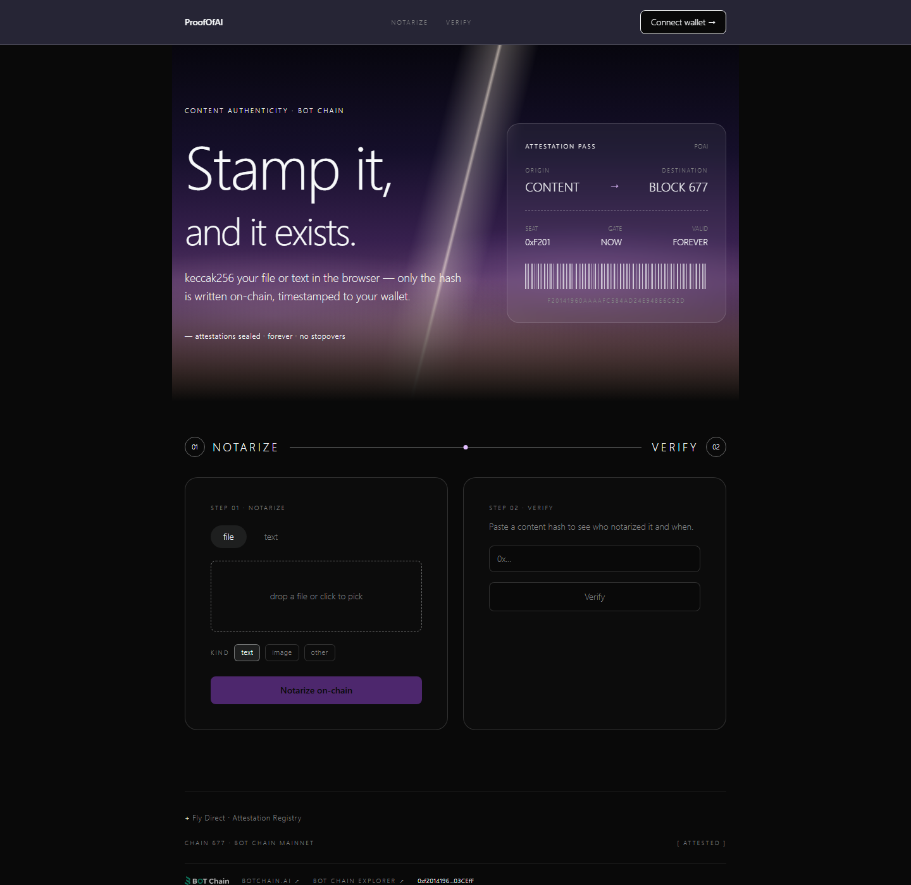
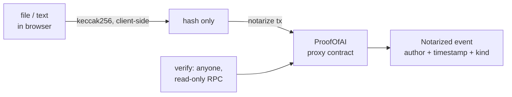

# ProofOfAI — Content Authenticity on BOT Chain

Prove a file, image or text existed at a point in time. The content is
hashed in the browser — only the keccak256 goes on-chain, timestamped to
your wallet forever.

**Contract:** [`0xf2014196…03CEfF`](https://scan.botchain.ai/address/0xf20141960AaAafC584ad24E948e6c92dfA03CEfF)
(UUPS proxy on BOT Chain mainnet, chain 677)
**Repo:** github.com/DruxAMB/ProofOfAi



## The problem

A creator posts work; weeks later a dispute over who made it first can't
be settled by file metadata — it can be edited freely. A public timestamp
anchored to a wallet settles it, but only if the timestamp can't be
forged and the content never has to be uploaded anywhere.

## What it does

- **Notarize** — drop a file or paste text; the app keccak256-hashes it
  in the browser and writes `hash + kind + timestamp` on-chain from your
  wallet. The file itself never leaves the machine.
- **Verify** — paste any `0x…` hash to see whether it was notarized, by
  whom, and when.
- **Duplicate protection** — re-notarizing an identical hash reverts
  (`already notarized`); one content, one record.

## How it works



The hard part the contract solves: **a stable address the registry can
outgrow.** The implementation is UUPS-upgradeable behind an ERC1967
proxy, so fixes and additions land without ever changing the address
consumers verify against.

## Built with

| Choice | Why |
|---|---|
| BOT Chain (chain 677) | Target network; 0.75s blocks make notarization feel instant |
| UUPS + ERC1967 proxy | Upgradeable implementation, permanent address |
| Next.js 16 (App Router) + TypeScript | Single-page dApp, static export friendly |
| ethers v6 | Contract calls + wallet (EIP-6963 discovery) |
| dope.security design system | Midnight-terminal style, adapted — see [DESIGN.md](DESIGN.md) |
| Sonner | Transaction-state toasts |

## Real vs. mocked

Nothing is mocked. Every notarization is a real transaction on BOT Chain
mainnet; every verification is a real read against the deployed proxy.

## Run locally

```bash
cd app && npm install && npm run dev   # no env needed — mainnet is the default
```

Deploy a fresh copy instead (needs `DEPLOYER_KEY`, never committed):

```bash
npm install
cp .env.example .env    # fill DEPLOYER_KEY + OWNER_ADDRESS
npm run deploy          # writes deployed.json + app/src/lib/contract.ts
```

## Contract surface

`contracts/ProofOfAI.sol` — UUPS-upgradeable behind an ERC1967 proxy
(stable address). Vendored OpenZeppelin sources live in `contracts/lib/`
so a fresh clone compiles.

- `notarize(bytes32 contentHash, uint8 kind)` — kind: 0 text · 1 image ·
  2 other → `Notarized` event; duplicates revert
- `verify(bytes32)` → `exists, author, timestamp, kind`
- `totalNotarized()`

## Known limitations

- Proves existence-at-time, not authorship of the *content itself* —
  whoever notarizes first owns the record; plagiarism check is out of scope
- No enumeration UI yet — records are only retrievable by hash
- Reads go through the public RPC; a congested endpoint shows as
  "RPC hiccup" toasts rather than a degraded mode

## Licenses

- Project: MIT — see [LICENSE](LICENSE)
- OpenZeppelin contracts: MIT (`contracts/lib/`)
- Inter, JetBrains Mono, Lora: SIL OFL (`next/font`, self-hosted)
- Design adapted from the dope.security system (Refero Styles) — fonts
  substituted, no brand assets reused
- "BOT Chain" wordmark: BOT Chain brand kit (official asset, used per
  ecosystem branding requirements)
